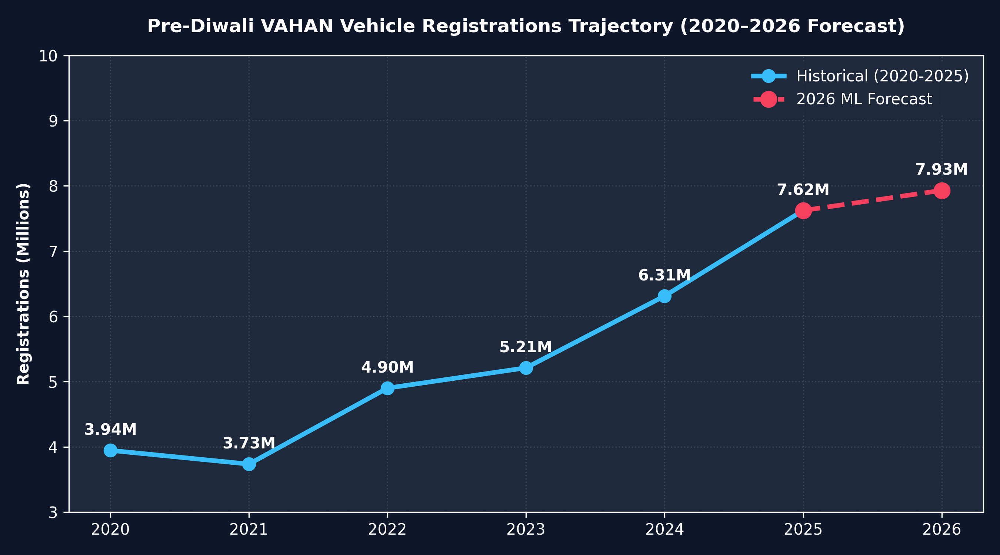
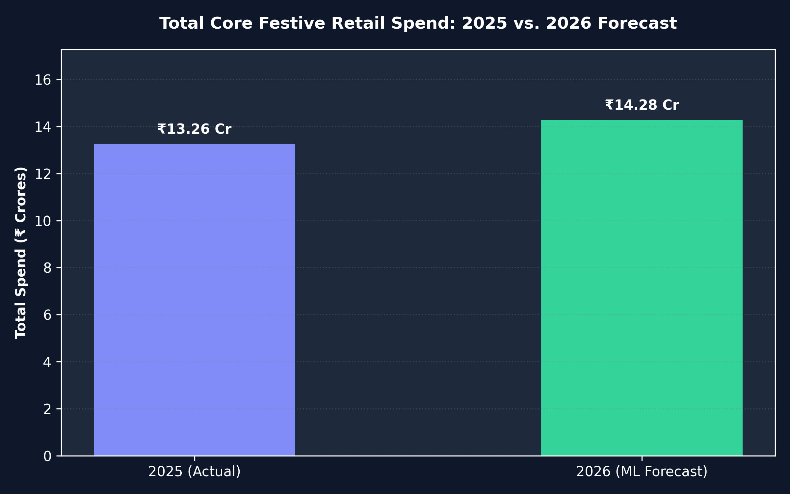
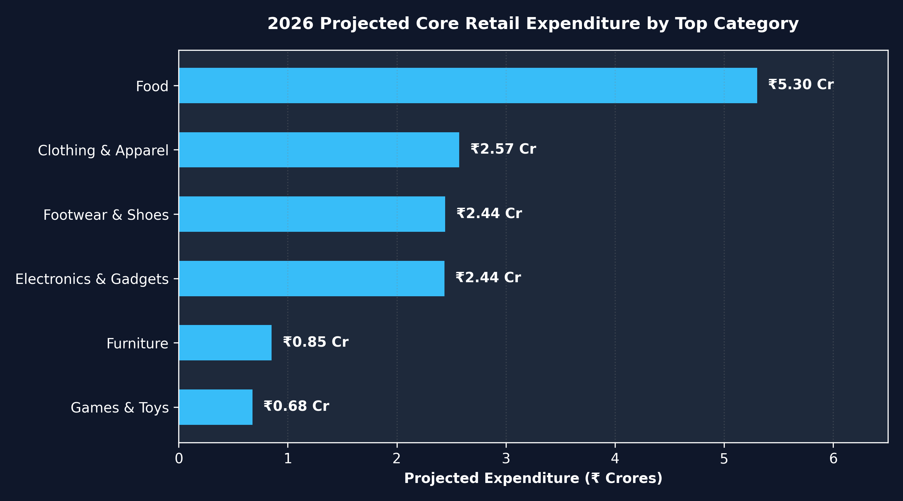
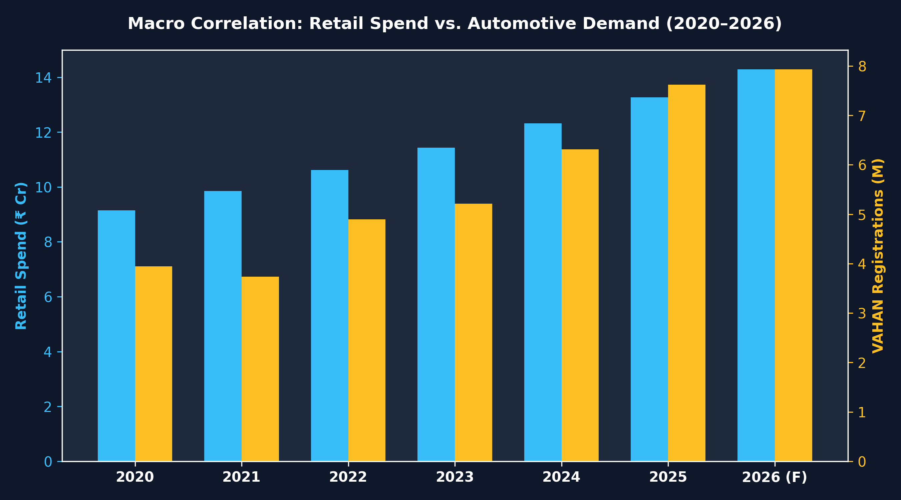
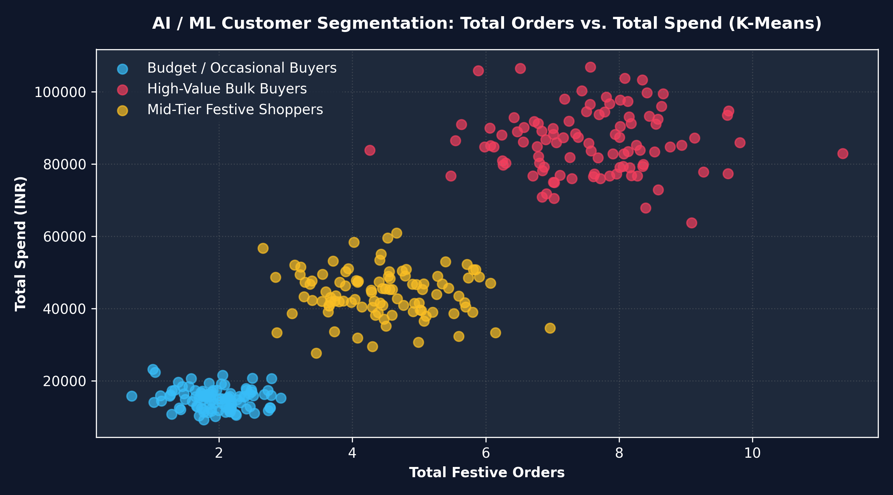

# India's Diwali Economy (2020–2026)

### An End-to-End Data Analytics and Machine Learning Project

An analytical exploration of India's Diwali economy, examining festive retail spending, gold market trends, confectionery sales, fireworks industry indicators, and vehicle registration patterns using Python, SQL, and Machine Learning.

This project integrates multiple datasets to explore India's festive economic activity through data cleaning, database management, exploratory data analysis, predictive modelling, spending-pattern segmentation, and data visualization.

## Project Objectives

- Analyze major economic sectors associated with India's Diwali economy.
- Examine historical vehicle registration and festive spending trends.
- Explore retail spending patterns and category-wise consumer behaviour.
- Apply Linear Regression to forecast 2026 festive vehicle registrations and retail spending.
- Implement K-Means Clustering to identify spending-based customer segments.
- Integrate multiple datasets into a structured SQLite database.
- Present analytical findings through visualizations and statistical insights.

## Tech Stack

| Category | Technologies |
|---|---|
| Programming | Python |
| Database | SQLite |
| Query Language | SQL |
| Data Manipulation | Pandas, NumPy |
| Machine Learning | Scikit-learn |
| Predictive Modelling | Linear Regression |
| Clustering | K-Means |
| Feature Scaling | StandardScaler |
| Data Visualization | Matplotlib |
| Data Sources | CSV, XLSX, PDF |

## Datasets

The project combines multiple datasets covering different sectors of India's festive economy.

| Dataset | Description |
|---|---|
| VAHAN Year-wise | Annual vehicle registration data for 2020–2026 |
| VAHAN Monthly (2020–2022) | Monthly vehicle registration trends |
| VAHAN Monthly (2023–2025) | Monthly vehicle registration trends |
| India Confectionery Market | Historical and forecast confectionery market data |
| Diwali Sales | Retail transaction data containing customer and product spending information |
| World Gold Council | Gold market statistics and historical trends |
| PESO Authorized Fireworks Manufacturers | Information on authorized fireworks manufacturers |

**Data Coverage Note:** The datasets have different reporting periods, geographical coverage, and levels of granularity. Not every dataset directly measures Diwali-specific expenditure. The analysis distinguishes between festive retail transaction patterns, broader market indicators, and vehicle registration activity.

## Project Workflow

### 1. Data Collection and Preparation

- Collected datasets from multiple sources in CSV, Excel, and PDF formats.
- Inspected data structures, column types, missing values, and inconsistencies.
- Cleaned and transformed datasets using Python.
- Prepared datasets for structured storage and subsequent analysis.

### 2. Database Management and SQL

- Created a local SQLite database named `diwali_economy.db`.
- Integrated retail transaction and VAHAN vehicle registration datasets.
- Stored structured data in database tables.
- Used SQL queries to retrieve, filter, aggregate, and analyze relevant information.

### 3. Exploratory Data Analysis

Conducted exploratory analysis to investigate:

- Year-wise vehicle registration trends.
- Monthly vehicle registration patterns.
- Year-over-year changes in festive spending.
- Major retail spending categories.
- Gold and confectionery market trends.
- Relationships between selected economic indicators.

### 4. Predictive Modelling

Implemented Linear Regression using Scikit-learn to:

- Analyze historical trends in vehicle registrations and retail spending.
- Develop forecasting models for 2026.
- Compare predicted values with available historical observations.
- Explore potential future trends in festive economic activity.

### 5. Spending Pattern Segmentation

Applied K-Means Clustering to explore spending patterns.

Key techniques:

- Standardized numerical features using `StandardScaler`.
- Applied K-Means to group observations based on spending characteristics.
- Visualized the resulting clusters using scatter plots.
- Explored differences between the identified spending segments.

### 6. Data Visualization

Developed five custom visualizations using Matplotlib with a consistent dark-themed design.

The visualizations highlight historical trends, year-over-year changes, spending categories, economic relationships, and spending-based segmentation.

## Project Visualizations

### 1. VAHAN Vehicle Registration Trends



### 2. Year-over-Year Spending Trends



### 3. Top Spending Categories



### 4. Macroeconomic Correlation Analysis



### 5. Spending Pattern Segmentation



## Repository Structure

```text
India-Diwali-Economy-Analysis/
│
├── data/
│   ├── 2020 -2026 vahan year.csv
│   ├── 2020-2022 montwise vahan.csv
│   ├── 2023-2025 montiwse vahan.csv
│   ├── dataset_4_india_confectionery.csv
│   ├── Diwali Sales Data.csv
│   ├── GDT Tables_Q326_EN.xlsx
│   └── PESO_Authorized_Fireworks_Manufacturers.pdf
│
├── output/
│   ├── linkedin_1_vahan_trend.png
│   ├── linkedin_2_yoy_spend.png
│   ├── linkedin_3_top_categories.png
│   ├── linkedin_4_macro_correlation.png
│   └── linkedin_5_scatter_segmentation.png
│
├── diwali_cleaning.py
├── diwali_database.py
├── diwali_economy.db
└── README.md
```

## Installation and Setup

### 1. Clone the Repository

```bash
git clone https://github.com/sharadashenoy18/India-Diwali-Economy-Analysis.git

cd India-Diwali-Economy-Analysis
```

### 2. Install Dependencies

```bash
pip install pandas numpy matplotlib scikit-learn openpyxl
```

SQLite is supported through Python's built-in `sqlite3` module.

### 3. Run Data Cleaning

```bash
python diwali_cleaning.py
```

### 4. Set Up the Database

```bash
python diwali_database.py
```

Follow the scripts' actual execution requirements if they expect a particular order or an existing database.

## Key Learning Outcomes

- Developed an end-to-end data analytics workflow using multiple data sources.
- Gained practical experience in data cleaning, transformation, and integration.
- Applied SQL and SQLite for structured data management and querying.
- Implemented Linear Regression for predictive analytics.
- Applied K-Means Clustering for spending-pattern segmentation.
- Used feature scaling to prepare numerical data for clustering.
- Developed custom visualizations to communicate analytical findings.
- Explored relationships between consumer spending and broader economic indicators.

## Limitations

- The datasets have different reporting periods, geographical coverage, and levels of granularity.
- Some datasets represent broader market activity rather than direct Diwali expenditure.
- Forecasts are model-based estimates and should not be interpreted as confirmed economic outcomes.
- Customer segments are exploratory statistical groupings and do not necessarily represent verified real-world customer categories.
- Correlation analysis identifies statistical relationships, not causation.
- Forecast reliability depends on the available historical data and model assumptions.

## Author

**Sharada Shenoy**

M.Sc. Computer Science | Data Analytics Enthusiast

- LinkedIn: [Sharada Shenoy](https://linkedin.com/in/sharada-shenoy-665a79275/)
- GitHub: [sharadashenoy18](https://github.com/sharadashenoy18)

---

*An independent Data Analytics and Machine Learning project exploring India's Diwali economy from 2020 to 2026.*
